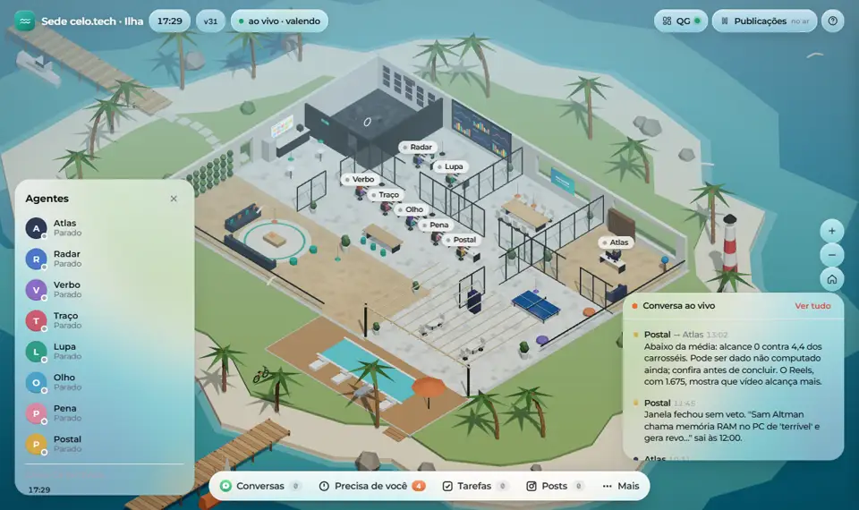
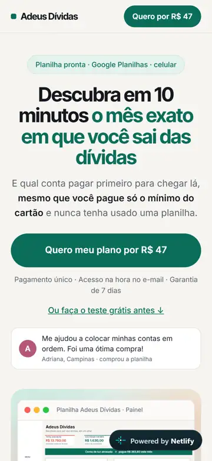
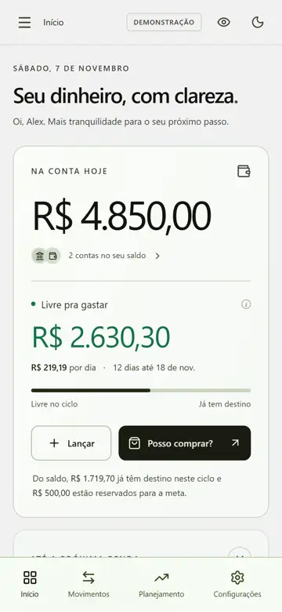
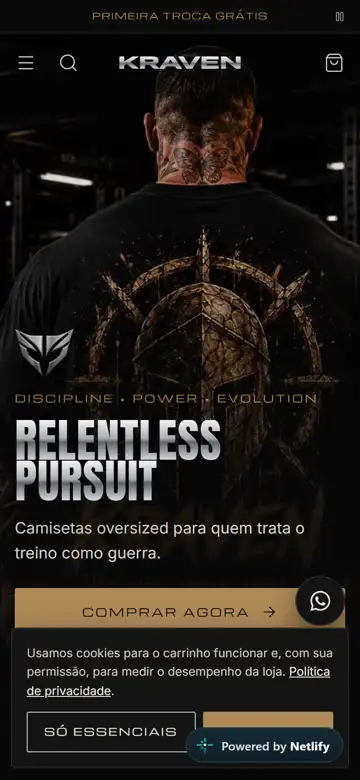
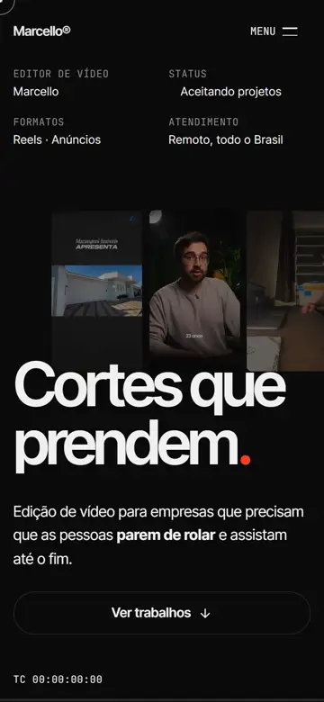

# Marcello De Paoli · Portfólio

**Vibe coder.** Construo sistemas com Claude Code que fazem o trabalho sozinhos: editam vídeo, publicam conteúdo, prospectam clientes e vendem produto digital.

[Instagram @celo.tech](https://www.instagram.com/celo.tech/) · [GitHub](https://github.com/depaolii)

---

## Projetos

| Projeto | O que é | Link |
|---|---|---|
| [Editor de Reels automático](#1-editor-de-reels-automático) | Vídeo bruto entra, Reels editado e postado sai | [@celo.tech](https://www.instagram.com/celo.tech/) |
| [Sede de agentes de IA](#2-sede-celotech-empresa-de-agentes-de-ia) | 8 agentes que tocam o meu Instagram, num escritório 3D | Demo abaixo |
| [Planilha Adeus Dívidas](#3-planilha-adeus-dívidas-produto-digital-com-vendas-reais) | Produto digital com página, checkout e anúncios rodando | [no ar](https://planilha-adeus-dividas.netlify.app) |
| [Sobra](#4-sobra-saas-de-finanças-pessoais) | SaaS de finanças em Next.js + Supabase | Demo abaixo |
| [Loja KRAVEN](#5-loja-kraven) | E-commerce completo de roupa fitness | [no ar](https://kraven-loja.netlify.app) |
| [Site da Algup](#6-site-da-algup) | Site de agência feito para vender pelo WhatsApp | [no ar](https://algup.netlify.app) |
| [Portfólio de edição](#7-portfólio-de-edição-de-vídeo) | One-page com vídeos para captar clientes | [no ar](https://marcello-portfolio.pages.dev) |
| [Robô SDR de prospecção](#8-robô-sdr-de-prospecção) | Acha leads, escreve a 1ª mensagem e conduz até a reunião | Código privado (dados de leads) |

---

## 1. Editor de Reels automático

**O que faz:** eu mando só o vídeo bruto e o roteiro. O sistema corta pausas e erros de fala, busca vídeos de apoio em bancos de imagem, monta a tela dividida, coloca legenda, música, efeitos e cor, e manda para o meu Telegram. Eu aprovo pelo celular e ele posta no horário.

**Como construí:** Claude Code + Python + ffmpeg, organizado em *skills*. Cada tipo de vídeo tem as próprias regras, e cada correção que eu faço vira regra nova. Hoje tenho skills para Reels pessoais, Reels de notícia, motion graphics, anúncios da Óticas Góes (5 criativos aprovados pelo cliente), imóveis da Marangoni, cosméticos da Tuon e vídeos de casamento.

À esquerda, o bruto de 4min08. À direita, o Reels de 1min45 que o sistema entregou. <a href="demos/reels-bruto-vs-final.mp4">Ver com som</a>

---

## 2. Sede celo.tech: empresa de agentes de IA

**Problema:** produzir conteúdo todo dia sozinho, sem equipe.

**O que faz:** 8 agentes (Atlas, Radar, Verbo, Traço, Lupa, Olho, Pena, Postal) pesquisam notícias de IA, escrevem, desenham carrosséis e publicam 2 posts por dia no @celo.tech. Eu só gravo o Reels de manhã e acompanho pelo painel. O escritório é um mapa 3D ao vivo: dá para ver cada agente trabalhando, a fila do dia, o que já saiu, o que precisa de mim e os resultados de cada post.

**Como construí:** Node.js, Three.js na cena 3D, rotinas agendadas, Claude Code rodando cada tarefa e integração com Telegram e Instagram. O executor de tarefas foi adaptado de um projeto do meu irmão, Gui De Paoli.

---

## 3. Planilha Adeus Dívidas: produto digital com vendas reais

**Problema:** validar um produto digital barato do zero.

**O que fiz:** criei a planilha, a página de vendas, os bônus, o checkout na Kiwify e as campanhas no Meta Ads com teste A/B de criativos e UTMs passando até o checkout. O produto já tem compradores reais, e os depoimentos na página são deles.

---

## 4. Sobra: SaaS de finanças pessoais

**Problema:** apps de finanças mostram o que você gastou, mas não respondem a pergunta que importa: *quanto ainda posso gastar até a próxima renda?*

**O que faz:** mostra o saldo, o "Livre pra gastar" por dia e os compromissos do mês, e tem um simulador "Posso comprar?" que diz se uma compra cabe, à vista ou parcelada.

**Como construí:** Next.js 16, React 19, TypeScript, Supabase (PostgreSQL), Zod e testes E2E com Playwright, a partir de um PRD. Está em desenvolvimento: o modo demonstração funciona, e o backend no Supabase ainda não foi validado com um projeto real.

---

## 5. Loja KRAVEN

E-commerce de camisetas oversized de academia: catálogo com filtros, páginas de drop, carrinho com barra de frete grátis, kit "Leve 3" com desconto automático, cupom, "Qual meu tamanho?" e checkout (em modo demonstração, sem cobrança). Next.js com exportação estática.

---

## 6. Site da Algup

Site de uma agência de audiovisual e tráfego pago, feito para ser enviado por WhatsApp a quem pode virar cliente: tem que convencer numa única visita, pelo celular e em conexão ruim. HTML, CSS e JS puros, com hero animado por quadros e vídeos otimizados.

---

## 7. Portfólio de edição de vídeo

One-page dark com os meus trabalhos de edição em vídeo vertical e um botão para chamar no WhatsApp.

---

## 8. Robô SDR de prospecção

Robô de vendas para a Algup, nas versões WhatsApp e Instagram. A base é um projeto do meu irmão, Gui De Paoli. Eu adaptei para Windows, mudei o público e as ofertas, e criei a versão de Instagram. Ele acha profissionais autônomos, avalia o site de cada um, escreve a primeira mensagem de um jeito humano, conversa seguindo o SPIN Selling, faz follow-up e leva o lead até a reunião. Tem CRM em Google Sheets e painel. No Instagram é semiautomático, de propósito, para não arriscar a conta: o robô escreve e eu envio.

*O código é privado porque guarda dados de leads (LGPD).*

